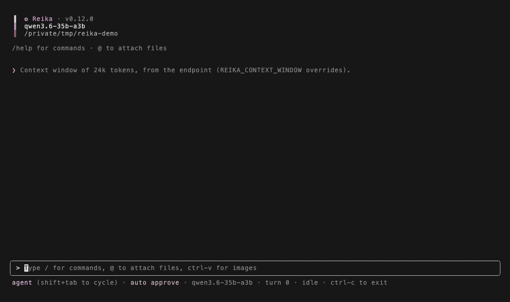
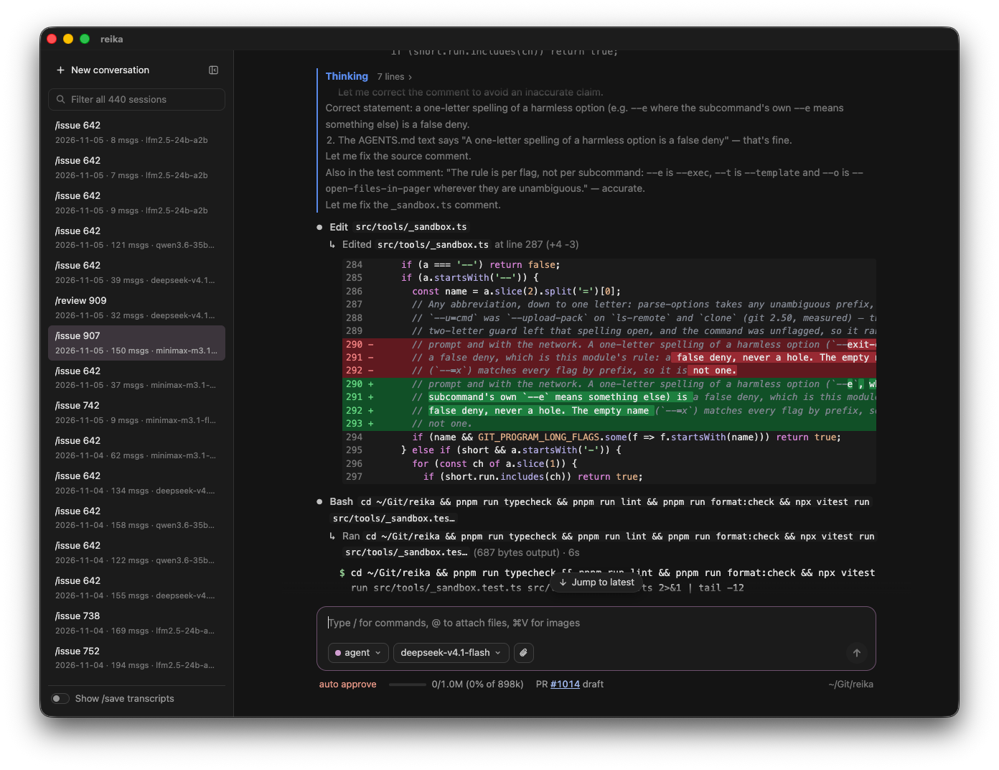

<p align="center">
  <picture>
    <source media="(prefers-color-scheme: dark)" srcset="docs/assets/reika-dark.svg">
    
  </picture>
</p>

<p align="center">
  A coding agent CLI for local and hosted models,<br>
  designed around small local models first.
</p>

<p align="center">
  <a href="https://reikacode.com">Website</a> ·
  <a href="#quick-start">Quick start</a> ·
  <a href="#documentation">Docs</a> ·
  <a href="docs/models.md">Tested models</a> ·
  <a href="README.zh-CN.md">简体中文</a>
</p>



<sup>A real local run of Qwen3.6 35B A3B (Unsloth UD-IQ2_M) via llama.cpp, sped up 3×. The model fixes its own indentation, adds a test for the delays, and the tests pass on the first run.</sup>

Reika is a coding agent CLI for local and hosted models. It was designed around small local models first (8B–35B, often at Q2–Q4, on a 16–32k context window), so it is careful with context, fails gracefully, and tells you when it's stuck.

It doesn't make a small model smarter. It makes working with one less frustrating: less of the window wasted, fewer loops over the same read, and less chance of the task quietly getting lost.

It gets used and tested on both: small local models through llama.cpp, and large hosted ones through their APIs. At the small end, expect a better experience rather than frontier results. In testing, 14–35B models handled multi-file tasks most reliably, 8–9B models managed simple, well-scoped ones, and 4B-class models ran end to end but rarely got past short tasks.

Reika is pre-1.0, so commands, settings and behavior can still change between releases.

## What the measurements say

Reika's design choices were measured rather than assumed, and the results are published. They show what a harness can and can't do about the problems small models run into, not how much better the models get. The short version is below; the runs and numbers behind it are in [docs/findings.md](docs/findings.md).

- **The harness's own context management cost more than the model did.** One rewrite in the middle of the context re-processed 8,453 tokens of prompt (7.9 minutes of prefill), where an append in the same session cost 25 tokens and 3.5 seconds.
- **Ask the model for its findings before a fold drops them.** In the A/B behind this, the arm whose findings were dropped folded five times, re-read files it had already read, and never answered; the arm that was asked answered from the digest.
- **A small model takes tool output literally.** A grep that said "0 matches" for a call it couldn't serve sent a model rewording a correct pattern for five rounds. A loop blamed on a 35B at Q2 turned out to be Reika feeding the model its own tool-call markup.
- **Prompt wording is the weakest lever.** On a vague task at Q2, a model converges or spirals about half the time each. The harness can't move that rate, only what the failing half costs.
- **The loop detectors separate cleanly.** Healthy reasoning rounds measure 0.2–0.3 on cross-round similarity, locked loops sit at 1.00, and a productive 38-round turn never set the detector off.

## Highlights

- **Context discipline.** Old tool output collapses to one-line summaries. Requests only grow by appending until the context has to shrink, so the engine's prompt cache survives. When the window fills, the model writes a note of its findings before older turns fold into a recap.
- **Loop and spiral breaking.** Repeated reads, reasoning that goes over the same ground, and runaway thinking blocks are caught and answered in escalating steps (a nudge, a pinned reminder, pausing the read tools, then an honest stop) instead of a 30-minute spiral.
- **Checks on what the model does.** An edit to a file the model hasn't read is sent back for a read first, TypeScript edits are typechecked against the state before the edit, and a written plan is tracked step by step from what actually happened, not from what the model claims.
- **A mode for the job.** Agent mode is the default and does the work directly. The others are there when a task calls for them: plan mode explores read-only and ends in a numbered, file-specific plan you can refine before running it; grind takes a harder change through defining done, testing and review; minimal keeps a small window lean; and chat answers without the repo.
- **Safe by default.** Ordinary edits run, dangerous commands still prompt, and on macOS model-chosen shell commands run under a kernel sandbox (writes confined to the project, network denied).
- **Extensible.** Stdio MCP servers add tools, and each tool also becomes a slash command. Markdown skills become slash commands too. `/issue` and `/review` ship with Reika and show up in any repo with `gh` installed and a GitHub remote.
- **No telemetry.** Your code goes to the model server you configure and nowhere else: with a local server it never leaves your machine, and with a cloud API it goes to that provider. The only other requests are the web tools (when the model uses one or you paste a link), a download of the public models.dev catalog to look up context limits (hosted endpoints only, and never with your data), and whatever the MCP servers you configure do on their own.
- **Built for slow local engines.** It waits out long prefills, understands the tool-call formats that models without a native template fall back to, and shows decode speed, context fill and cache hit rate in the status bar.

## Requirements

- Node.js 22 or newer (macOS 11+ or glibc 2.28+ Linux — see [Platforms](docs/platforms.md)).
- An OpenAI-compatible model server: llama.cpp, MLX, vLLM, or a cloud API.
- macOS is the primary platform. Linux works, but without the shell sandbox or image-paste OCR (set `REIKA_VISION_MODEL` to read pasted images with a vision model instead). Windows may work under WSL2.
- A modern terminal such as iTerm2, Ghostty or Kitty, so the TUI renders properly.

## Quick start

Install it with any of these (npm and pnpm need Node ≥ 22; Homebrew pulls Node in):

```sh
npm i -g @alexwkleung/reika
pnpm add -g @alexwkleung/reika
brew install alexwkleung/tap/reika
```

Serve a model, for example with llama.cpp:

```sh
llama-server -m <model.gguf> -c 24576 --jinja <other-launch-args>
```

Then point Reika at it:

```sh
export REIKA_MODEL=model  # or put it in ~/.config/reika/.env
cd your-project && reika
```

Using a hosted API instead? Skip the server and set `REIKA_BASE_URL`, `REIKA_API_KEY` and `REIKA_MODEL` to the provider's endpoint, your key and its model id; [Install and first run](docs/getting-started.md#hosted) has the details.

`REIKA_BASE_URL` defaults to `http://localhost:9931/v1`, llama-server's default since llama.cpp v0.7.0 (older builds and its Docker images use 8080). The context window is read from the server when it reports one, and for hosted endpoints from the models.dev catalog; set `REIKA_CONTEXT_WINDOW` when neither has it. Reika sends no sampling parameters of its own, so your server's flags are what apply.

To run from a checkout instead, `git clone https://github.com/alexwkleung/reika.git && cd reika`, then `pnpm install` (npm users: `npm i -g pnpm` first). From there, `pnpm run install:global` builds and installs the `reika` binary, or `cp .env.example .env` and `pnpm run dev` runs it without installing. `pnpm run uninstall:global` removes the global binary.

Prefer a window to a terminal? `reika web` serves the same agent to a browser tab on this machine, and `reika web --window` opens it in its own app window. It's experimental; [docs/web.md](docs/web.md) covers what it does and what it doesn't do yet.



## Common configuration

Set these in your shell, a project `.env`, or `~/.config/reika/.env` (in that order of precedence). The full list, experimental flags, and multi-model profiles are in [docs/configuration.md](docs/configuration.md).

| Key                    | Default                    | What                                                                                  |
| ---------------------- | -------------------------- | ------------------------------------------------------------------------------------- |
| `REIKA_MODEL`          | _required_                 | Model name, or a comma-separated list served by the same endpoint                     |
| `REIKA_BASE_URL`       | `http://localhost:9931/v1` | OpenAI-compatible endpoint                                                            |
| `REIKA_API_KEY`        | `no-key`                   | API key (any non-empty value for local servers)                                       |
| `REIKA_CONTEXT_WINDOW` | _probed from the server_   | Context window in tokens; drives compaction, the context gauge, and the repo map size |
| `REIKA_MIN_GEN_TOKENS` | _learned_ (from `2048`)    | Room reserved for the reply; learned from the model's rounds, set it to pin           |
| `REIKA_AUTO_APPROVE`   | `safe`                     | `off` confirms every edit and command; `bypass` confirms nothing                      |

## Modes

`Shift+Tab` cycles through the modes, or switch with a slash command. The next session opens in the mode and model you ended the last one in.

| Mode      | What it does                                                                 |
| --------- | ---------------------------------------------------------------------------- |
| `agent`   | The default: the model reads, edits, and runs commands                       |
| `plan`    | Read-only exploration that ends in a written plan; `/implement` runs it      |
| `vibe`    | Plans first, then implements the plan, on every prompt                       |
| `minimal` | Shell only, with no repo map or project context loaded upfront               |
| `grind`   | Agent turns run a fixed, careful procedure: define done, test, review        |
| `chat`    | Plain conversation with a separate history; web tools only                   |
| `shell`   | Your input runs as a shell command, and the output joins the agent's context |

`reika -p "<prompt>"` runs a single turn headless and prints the reply, for scripts and other harnesses. See [docs/usage.md](docs/usage.md) for modes in detail, headless flags, and every slash command.

## Safety

- **Approvals** default to `safe`: ordinary edits and commands run on their own, but a dangerous command (`rm -rf`, a force push, a package install, `curl`) or a write outside the project still asks you first. `bypass` can only be set at launch, never mid-session.
- **Sandbox** (macOS, on by default): model-chosen shell commands can write only inside the project, temp, and cache directories, and have no network apart from loopback and read-only `git`/`gh`. A command you explicitly approve runs unsandboxed. `REIKA_SANDBOX=0` turns it off.

Found a way around one of these? Report it privately; see [SECURITY.md](SECURITY.md).

## Documentation

The same pages are on the website, [reikacode.com](https://reikacode.com).

| Doc                                              | Covers                                                                                      |
| ------------------------------------------------ | ------------------------------------------------------------------------------------------- |
| [Install and first run](docs/getting-started.md) | Requirements, installing, serving a model, and the first run                                |
| [Configuration](docs/configuration.md)           | Every `.env` key, experimental flags, named profiles, last-session state                    |
| [Modes, headless, commands](docs/usage.md)       | Each mode in depth, `reika -p`, slash commands, `/save` transcripts                         |
| [Web front end](docs/web.md)                     | `reika web` and `--window`: the page, history, what is not there yet, how it is locked down |
| [Tools](docs/tools.md)                           | The model's tools, approval prompts, web search setup, MCP servers, `.gitignore`            |
| [Instructions and skills](docs/skills.md)        | `AGENTS.md`, skills as slash commands, plain-English routing, pasted URLs                   |
| [Tested models](docs/models.md)                  | Local quants and APIs Reika has been run against                                            |
| [Findings](docs/findings.md)                     | The measured record: what broke, what held, and how each number was obtained                |
| [Platforms](docs/platforms.md)                   | Requirements, running on a weak machine, what differs on Linux and Windows                  |
| [Architecture and caveats](docs/architecture.md) | How the harness works, and known limitations                                                |
| [Contributing](CONTRIBUTING.md)                  | Scripts, design philosophy, a pointer to `AGENTS.md`, and external contributor guidelines   |
| [Changelog](CHANGELOG.md)                        | What changed in each release                                                                |

## Inspired by

Claude Code, Codex, Crush, OpenCode, Pi, Aider, DeepSeek Harness, Qwen Code, Kimi Code CLI, Gemini CLI, Junie, DS4, and Ante.

## Citation

If you use Reika in your work, you can cite it as:

```bibtex
@software{reika2026,
  author = {Leung, Alex},
  title  = {Reika},
  year   = {2026},
  url    = {https://github.com/alexwkleung/reika}
}
```

GitHub's "Cite this repository" button gives the same entry in other formats, from [CITATION.cff](CITATION.cff).

## License

Apache License 2.0. See [LICENSE](LICENSE) and [NOTICE](NOTICE).

## Supporting our work

If Reika is useful to you, consider supporting it via [GitHub Sponsors](https://github.com/sponsors/alexwkleung), [Ko-fi](https://ko-fi.com/alexwkleung), or [Buy Me a Coffee](https://buymeacoffee.com/alexwkleung). See [Support](docs/support.md) for what it funds and other ways to help.

## Contact

Bugs go to [GitHub Issues](https://github.com/alexwkleung/reika/issues), questions and ideas to [Discussions](https://github.com/alexwkleung/reika/discussions), and security reports go through [SECURITY.md](SECURITY.md). For anything else, email [hello@reikacode.com](mailto:hello@reikacode.com).
