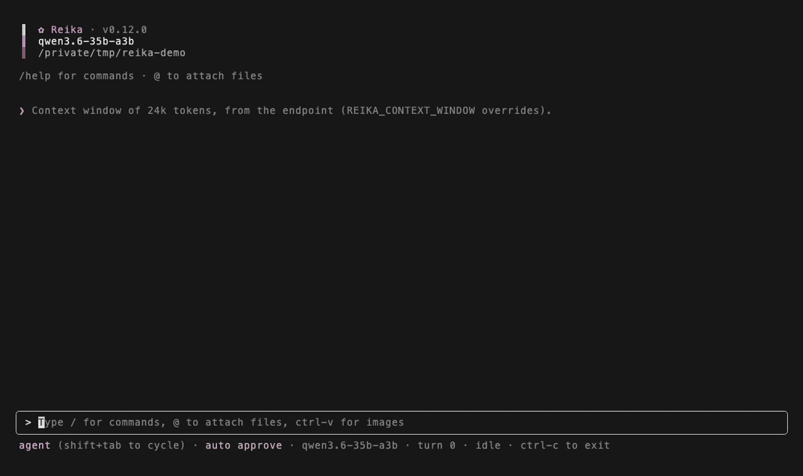
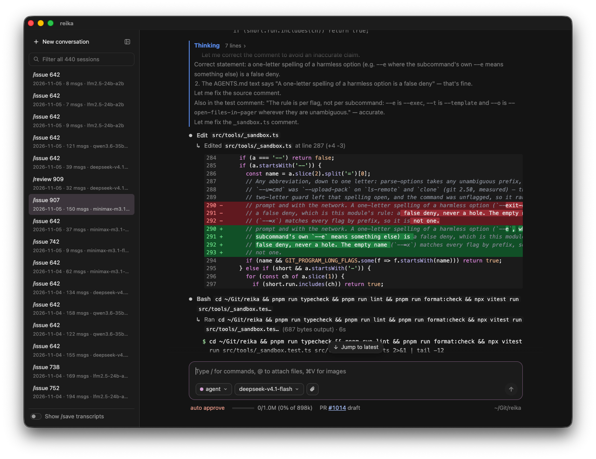

<p align="center">
  <picture>
    <source media="(prefers-color-scheme: dark)" srcset="docs/assets/reika-dark.svg">
    
  </picture>
</p>

<p align="center">
  适用于本地与托管模型的编码代理 CLI，<br>
  首先围绕小型本地模型设计。
</p>

<p align="center">
  <a href="https://reikacode.com/zh/">网站</a> ·
  <a href="#快速开始">快速开始</a> ·
  <a href="#文档">文档</a> ·
  <a href="docs/zh/models.md">测试过的模型</a> ·
  <a href="README.md">English</a>
</p>



<sup>一次真实的本地运行：Qwen3.6 35B A3B（Unsloth UD-IQ2_M）经 llama.cpp，加速 3×。模型修正了自己的缩进，为延迟添加了一个测试，第一次运行就全部通过。</sup>

Reika 是一个适用于本地与托管模型的编码代理 CLI。它首先围绕小型本地模型设计（8B–35B，通常处于 Q2–Q4，16–32k 上下文窗口），因此对上下文很节制，失败时更体面，卡住时会直说。它不会让小模型变得更聪明，只是让使用小模型的体验少一些挫败。

它在小型本地模型和大型托管模型上都有日常使用和测试。测试中，14–35B 模型处理多文件任务最可靠，8–9B 模型能完成简单、范围明确的任务，4B 级别的模型很少能完成简短任务以外的工作。Reika 还处于 1.0 之前，命令、设置和行为在不同版本之间仍可能变化。

## 亮点

- **上下文纪律。** 旧的工具输出折叠成一行摘要，引擎的 prompt 缓存保持有效；较早的轮次被折叠之前，模型会先写下自己的发现。
- **循环中断。** 重复读取和失控的推理会被检测到，并逐级升级地回应，最后以坦诚终止收场，而不是打转半小时。
- **对模型工作的检查。** 对未读文件的编辑会被退回，要求先读；TypeScript 编辑会做类型检查；计划进度按实际发生的事情追踪。
- **按任务选择模式。** 默认的 agent 模式直接完成工作；plan、grind、minimal 和 chat 在任务需要时使用（见[模式](#模式)）。
- **默认安全。** 危险命令仍会询问；在 macOS 上，shell 命令运行在内核沙箱里。无遥测。
- **可扩展。** Stdio MCP 服务器可以添加工具，Markdown 技能会变成斜杠命令，并内置 `/issue` 和 `/review`。
- **为慢速本地引擎而做。** 容忍长预填充，能处理没有原生工具调用模板的模型，并在状态栏显示解码速度、上下文占用和缓存命中率。

## 测量结果

Reika 的设计取舍是测量出来的，而不是假设的，结果公开在 [docs/findings.md](docs/findings.md)。举几个例子：

- **框架自己的上下文管理，代价比模型本身更大。** 一次发生在上下文中段的改写重新预填充了 8,453 个 token（7.9 分钟）；一次追加只花 25 个 token、3.5 秒。
- **小模型会照字面理解工具输出。** 一个被归咎于 Q2 下 35B 模型的循环，其实是 Reika 把模型自己的工具调用标记又喂了回去。
- **提示词措辞是最弱的杠杆。** 在 Q2 下面对含糊任务，模型大约有一半时间会打转。框架改变不了这个比例，只能改变失败那一半的代价。

## 要求

- Node.js 22 或更新版本（macOS 11+，或 glibc 2.28+ 的 Linux —— 见[平台](docs/zh/platforms.md)）。
- 一个 OpenAI 兼容的模型服务器：llama.cpp、MLX、vLLM 或云端 API。
- macOS 是主要平台。Linux 可用，但没有 shell 沙箱和图片粘贴 OCR（可以设置 `REIKA_VISION_MODEL`，改用视觉模型读取粘贴的图片）。Windows 或许能在 WSL2 下运行。
- 现代终端，例如 iTerm2、Ghostty 或 Kitty，以便 TUI 正确渲染。

## 快速开始

用以下任一方式安装（npm 和 pnpm 需要 Node ≥ 22；Homebrew 会自动装好 Node）：

```sh
npm i -g @alexwkleung/reika
pnpm add -g @alexwkleung/reika
brew install alexwkleung/tap/reika
```

启动一个模型（下面以 llama.cpp 为例），然后把 Reika 指向它：

```sh
llama-server -m <model.gguf> -c 24576 --jinja <other-launch-args>
export REIKA_MODEL=model  # 或写进 ~/.config/reika/.env
cd your-project && reika
```

托管 API、默认端口、上下文窗口以及从检出目录运行，见[安装与首次运行](docs/zh/getting-started.md)。

更喜欢窗口而不是终端？`reika web` 把同一个代理提供给本机的浏览器标签页，`reika web --window` 则在独立的应用窗口中打开它。这一功能仍是实验性的；它能做什么、暂时还做不到什么，见 [docs/web.md](docs/zh/web.md)。



## 常用配置

这些可以设在你的 shell、项目 `.env` 或 `~/.config/reika/.env` 中（优先级即此顺序）。完整列表、实验性开关和多模型 profile 见[配置文档](docs/configuration.md)。

| 键                     | 默认值                      | 说明                                                   |
| ---------------------- | --------------------------- | ------------------------------------------------------ |
| `REIKA_MODEL`          | _必填_                      | 模型名称，或同一端点提供的逗号分隔列表                 |
| `REIKA_BASE_URL`       | `http://localhost:9931/v1`  | OpenAI 兼容端点                                        |
| `REIKA_API_KEY`        | `no-key`                    | API 密钥（本地服务器填任意非空值）                     |
| `REIKA_CONTEXT_WINDOW` | _从服务器探测_              | 上下文窗口 token 数；驱动压缩和上下文占用条            |
| `REIKA_MIN_GEN_TOKENS` | _学习得到_（起始为 `2048`） | 为回复预留的空间；从模型的轮次中学习，设置它即固定该值 |
| `REIKA_AUTO_APPROVE`   | `safe`                      | `off` 让每次编辑和命令都需确认；`bypass` 什么都不确认  |

## 模式

`Shift+Tab` 循环切换模式，也可以用斜杠命令切换。你结束会话时所处的模式和模型，就是下次会话打开时的模式和模型。

| 模式      | 作用                                                     |
| --------- | -------------------------------------------------------- |
| `agent`   | 默认模式：模型读取、编辑并运行命令                       |
| `plan`    | 只读探索，最终产出一份写好的计划；`/implement` 执行它    |
| `vibe`    | 每次提示都先规划，再实现该计划                           |
| `minimal` | 仅 shell，不预先加载仓库地图和项目上下文                 |
| `grind`   | 代理轮次按固定而谨慎的流程运行：定义完成标准、测试、复查 |
| `chat`    | 与主历史分开的纯对话；只有网络工具                       |
| `shell`   | 你的输入作为 shell 命令运行，输出并入代理的上下文        |

`reika -p "<prompt>"` 无头运行单个轮次并打印回复，用于脚本和其他框架。模式细节、无头参数以及全部斜杠命令见[用法文档](docs/usage.md)。

## 安全与隐私

- **审批**默认是 `safe`：普通编辑和命令自行执行，但任何匹配危险模式的命令（`rm -rf`、强制推送、安装软件包、`curl`……）以及项目之外的任何写入，仍会先问你。`bypass` 只能在启动时设置，会话中无法切换。
- **沙箱**（macOS，默认开启）：由模型选择的 shell 命令只能写入项目、临时和缓存目录内，且除回环地址和只读的 `git`/`gh` 之外没有网络。你明确批准的命令不做沙箱隔离运行。`REIKA_SANDBOX=0` 可将其关闭。
- **无遥测。** 你的代码只会发往你自己配置的模型服务器，别处不去：用本地服务器时它从不离开你的机器，用云端 API 时它只发给该提供商。除此之外的请求只有：使用网络工具或粘贴链接时发起的请求；为查询上下文上限而下载公开的 models.dev 目录（仅针对托管端点，且从不携带你的数据）；以及你配置的 MCP 服务器各自的行为。

发现了绕过其中某一道的方式？请私下报告，见 [SECURITY.md](SECURITY.md)。

## 文档

这些页面也在网站 [reikacode.com/zh](https://reikacode.com/zh/) 上。模型、平台和架构已翻译为中文，其余页面暂为英文。

| 文档                                      | 内容                                                             |
| ----------------------------------------- | ---------------------------------------------------------------- |
| [配置](docs/configuration.md)             | 每一个 `.env` 键、实验性开关、具名 profile、上次会话状态         |
| [模式、无头与命令](docs/usage.md)         | 各模式详解、`reika -p`、斜杠命令、`/save` 会话记录               |
| [工具](docs/tools.md)                     | 模型可用的工具、审批提示、网络搜索设置、MCP 服务器、`.gitignore` |
| [指令与技能](docs/skills.md)              | `AGENTS.md`、作为斜杠命令的技能、自然语言路由、粘贴的链接        |
| [测试过的模型](docs/zh/models.md)         | Reika 实际跑过的本地量化版本和 API                               |
| [测量结果](docs/findings.md)              | 实测记录：什么坏了、什么撑住了，以及每个数字是怎么得到的         |
| [平台](docs/zh/platforms.md)              | 运行要求、在弱机器上运行、Linux 和 Windows 上的差异              |
| [架构与注意事项](docs/zh/architecture.md) | 框架如何工作，以及已知限制                                       |
| [贡献](CONTRIBUTING.md)                   | 脚本、设计理念、`AGENTS.md` 指引，以及外部贡献者指南             |
| [更新日志](CHANGELOG.md)（英文）          | 每个版本的变更                                                   |

## 灵感来自

Claude Code、Codex、Crush、OpenCode、Pi、Aider、DeepSeek Harness、Qwen Code、Kimi Code CLI、Gemini CLI、Junie、DS4 和 Ante。

## 引用

如果你在工作中使用了 Reika，可以这样引用：

```bibtex
@software{reika2026,
  author = {Leung, Alex},
  title  = {Reika},
  year   = {2026},
  url    = {https://github.com/alexwkleung/reika}
}
```

GitHub 的 "Cite this repository" 按钮会根据 [CITATION.cff](CITATION.cff) 给出其他格式的同一条目。

## 许可

Apache License 2.0。见 [LICENSE](LICENSE) 和 [NOTICE](NOTICE)。

## 支持我们的工作

如果 Reika 对你有用，可以考虑通过 [GitHub Sponsors](https://github.com/sponsors/alexwkleung)、[Ko-fi](https://ko-fi.com/alexwkleung) 或 [Buy Me a Coffee](https://buymeacoffee.com/alexwkleung) 支持这个项目。

## 联系

Bug 请提交到 [GitHub Issues](https://github.com/alexwkleung/reika/issues)，问题和想法请发到 [Discussions](https://github.com/alexwkleung/reika/discussions)，安全问题请按 [SECURITY.md](SECURITY.md) 私下报告。其他事情可以发邮件到 [hello@reikacode.com](mailto:hello@reikacode.com)。
