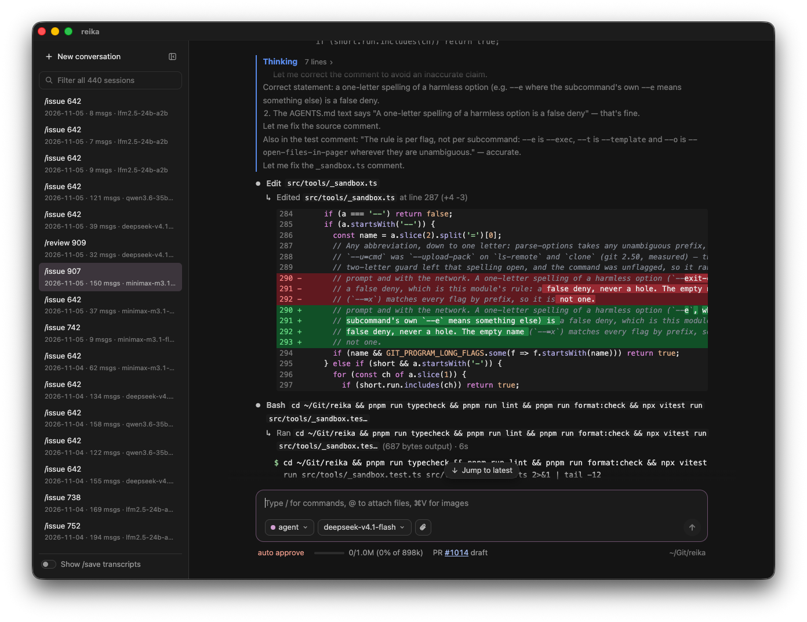

# Locking down a local web UI that can run commands

Reika 0.13.0 added a web front end. `reika web` serves the same agent the terminal runs to a browser tab, or to its own window with `--window`.

Prior to 0.13.0, the terminal has been the only way to operate Reika. The TUI is fast and is what terminal fanatics are used to, and an agent operating in that fashion is no different. But for someone that may come from nice and clean GUIs, operating an agent in the terminal doesn't feel as pleasant to use.

When it came to visuals, bringing over the TUI feel but keeping it familiar was kind of the goal. The TUI already has the foundation and it was designed as such. But having a web UI diverge for example just created extra work and after all it's just a fancy front end on top of the core.

As the web UI came to shape, I actually found myself liking it more or just as much as the TUI. But that doesn't mean I'm neglecting the TUI once the web UI got built. That's where it began but that's not where it ends. It's just that the TUI has had much more development time compared to the web UI.

One early architecture mistake, specifically centralizing all the TUI conversation logic in a single file cost a massive refactor just for the web UI to hook the existing components to. But I wouldn't consider it a mistake in this scenario though. That's because when Reika started, it never intended to go beyond the TUI or be worked on this much. While the refactor was mostly lifting all the necessary logic from the main entry point, it was mostly UI plumbing rather than the agent loop. That on its own avoided actual architectural mistakes because the TUI is just one dumb UI provider and the agent loop just hooks into it.

The UI can do anything the agent can (e.g., edit files, run shell commands, approve its own prompts if someone clicks the button). So a local server that serves it is a remote shell for anyone who can talk to it. Most of the work in [#584](https://github.com/alexwkleung/reika/issues/584) went into making sure the only one who can is the person who started it.

## Who else can reach a local server

A local server listening on localhost can be less protective than one thinks. With agents, there is a blast radius that might not be expected even when everything is local. Below are three things on the same machine that can still reach a port on `127.0.0.1`:

- Any website open in your browser. A page on another site can send requests to `localhost`. It usually can't read the replies, but for an agent, sending is enough to make it act.
- DNS rebinding. A domain the attacker controls can be pointed at `127.0.0.1` after the page loads, so the browser treats requests to the local server as the attacker's own site.
- The agent itself. Reika runs the model's shell commands in a sandbox, but that sandbox allows loopback on purpose (test suites start local servers). A command the model runs can connect to the web UI's port like any other.

The third one is the one specific to coding agents, and it shaped most of the design.

## What shipped

- Strict checks on every request. The server binds `127.0.0.1` only, and refuses any request whose `Host` header isn't exactly `127.0.0.1:<port>` or `localhost:<port>`. That stops rebinding, since a rebound domain still sends its own name. It also refuses a request whose `Origin` isn't one of those, and sends no CORS headers at all, so another site's page gets nothing back.
- No cookies. This is the decision I'd point at first. Cookies on `127.0.0.1` are shared across ports. So a server the model started on another loopback port inside the sandbox would receive the session cookie with every request the browser sent it, and could use it to drive the agent from outside the sandbox. Instead, the page holds a token and sets the `Authorization` header itself. Even the live event stream is read with `fetch` rather than `EventSource` because `EventSource` can't set headers.
- A single-use code in the link. The link you open carries a code after the `#`, which a browser never sends to a server or puts in a `Referer`. The page trades the code for the token once, and the code is dead after that, or after ten minutes. A link that leaks after it's used is worth nothing. One that leaks before is live for up to ten minutes, and only one tab can ever spend it.
- The sandbox can't reach the server's port. Reads are open in Reika's sandbox, so a model's command could in principle read the token out of the browser's profile on disk. So while the web server is running, the sandbox profile denies that one loopback port. Every other port stays open.
- The link never goes on a command line. `--window` launches a browser, and command-line arguments are visible to every user on the machine through `ps`. So the browser is pointed at a private redirect file instead of the link itself.

The full list is in the [web front end docs](../web.md#security), and the rules an edit must keep are spelled out in the repo's [AGENTS.md](https://github.com/alexwkleung/reika/blob/main/AGENTS.md).

## What it cost

- A new tab needs a new link. The token lives in the tab, not in a cookie, so opening the page in a second tab means pressing Enter in the terminal for a fresh link. This is a bit unintuitive but it keeps the moving parts down, so it's what works for now. A more ergonomic method may come later if it's a blocker.
- Only this machine. There's no way to open it from your phone or another computer. That's deliberate since remote access is a different trust and auth question, not a setting on this one.
- Strictness costs false refusals. A browser that sends unusual headers, or an extension that rewrites them, can get a 403 rather than a page.

There's still a lot to go for the web UI itself. And in the near future, a dedicated desktop app ([tracking in #1058](https://github.com/alexwkleung/reika/issues/1058)) is planned once the web UI becomes more stable so Reika won't require a terminal to use and download.
