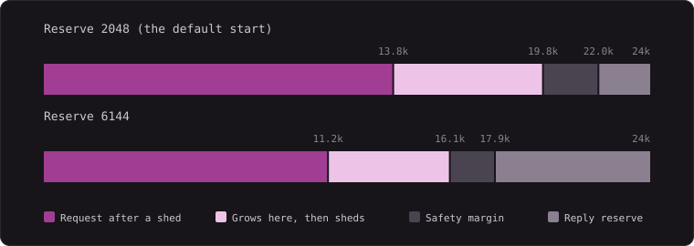

# Context management

[← README](../README.md)

How Reika divides a model's context window, and what it gives up as the window fills. For why each
decision went the way it did, with measurements, see [Findings](findings.md). For every setting, see
[Configuration](configuration.md).

## The window comes from the engine or from you

Most of this page needs a known context window. Reika takes the first of these that answers:

1. `REIKA_CONTEXT_WINDOW`, globally or per profile.
2. The endpoint's `/v1/models` listing: llama.cpp's `n_ctx` for the slot, vLLM's `max_model_len`.
3. The [models.dev](https://models.dev) catalog, for hosted endpoints only. Loopback and private hosts
   are never looked up.

If none of them answers, a startup warning says so. See [With no known window](#with-no-known-window)
for what that turns off.

## How the window is divided

Every budget derives from two numbers: the window, and the **generation reserve**, the room held back
for the model's reply. The reserve starts at 2048 tokens and rises to fit what the model actually
generates, up to a quarter of the window, unless `REIKA_MIN_GEN_TOKENS` pins it.

```
usable      = window − reserve
shed point  = usable × 0.9
shed target = shed point × 0.7
fold keeps  = usable × 0.3      recent turns, verbatim
recap       = usable × 0.1      everything older
max_tokens  = window − prompt − 384
```

Everything in the shed cycle comes down to one quantity, the window $W$ minus the reserve $G$:

$$
\underbrace{0.9(W - G)}_{\text{shed point}} \longrightarrow \underbrace{0.63(W - G)}_{\text{shed target}}
$$

In tokens, with the default reserve unless noted:

| Window | Reserve | Shed point | Shed target | Fold keeps | Recap budget | Repo map (chars) |
| ------ | ------- | ---------- | ----------- | ---------- | ------------ | ---------------- |
| 16k    | 2048    | 12.6k      | 8.8k        | 4.2k       | 1.4k         | 3200             |
| 24k    | 2048    | 19.8k      | 13.8k       | 6.6k       | 2.2k         | 4800             |
| 24k    | 6144    | 16.1k      | 11.2k       | 5.4k       | 1.8k         | 4800             |
| 32k    | 2048    | 27.0k      | 18.9k       | 9.0k       | 3.0k         | 6400             |
| 128k   | 2048    | 113.4k     | 79.4k       | 37.8k      | 12.6k        | 12000            |



<sup>A 24k window at two reserves. The fixed system prompt and bootstrap context sit at the left of every bar, so what is left for history is smaller than the colored span.</sup>

A larger reserve gives the model more room to think, and the shed point moves down to pay for it. The
reserve caps nothing: `max_tokens` is whatever the window has left, so it only binds on a spiral. It is
also held under the model's output limit when the catalog lists one, and under `REIKA_MAX_TOKENS` when
that is set.

The first part of every request is fixed for the session: the system prompt, the tool definitions, and
the bootstrap context. The repo map takes 5% of the window, between 3200 and 12000 characters. Skills,
modes and a project's `AGENTS.md` add to this, so read the real size from `ctx` on a first turn rather
than from the table. Whatever is left is history.

## Counting tokens without a tokenizer

Reika estimates at four characters per token, then corrects the estimate against what it can measure.
After each call it learns the ratio of the prompt tokens the engine reported to its own estimate, and
keeps that across turns. Code, JSON and CJK text tokenize denser than four characters per token, so:

- The shed and fold decisions never assume content is sparser than the four-character baseline, even
  when a prose-heavy session has taught a ratio below 1.
- Bytes this request adds for the first time are priced at 1.6 characters per token or denser, since
  nothing has measured them yet. Bytes an earlier request carried use the learned ratio.

## What happens as the window fills

**Below the shed point, requests only grow.** Tool results stay in full and each request is the
previous one plus the new round. On a local engine this is what keeps prefill cheap: the engine reuses
its cache up to the first byte that differs, so a request that only appends reprocesses only the
append. One edit to mid-history on a 27B cost 8453 tokens and 7.9 minutes of prefill, against 25 tokens
and 3.5 seconds for an append ([measured](findings.md#the-harnesss-own-context-management-cost-more-than-anything-the-model-did)).
Reika's job between shrink events is therefore not to touch what it already sent.

**A single large result is cut, not the history.** A new tool result can only take the room left after
everything else, shared between the results of that round. The task definition goes first, then the
newest read, then small results, and the rest split what remains. A cut keeps the start and end of
the result with a marker between them saying it hit the context limit. A long `bash`, `grep`, `glob` or
`fetch_url` result is also saved to a temp file the model can page through.

**At the shed point, the model writes a note first.** If the shrink coming up would fold something, one
extra round with tool calls forbidden asks the model what it has established, while it can still see
the full history. Reasoning does not survive a fold, so otherwise its conclusions go with it. A failed
or empty note folds without one, and a request already too large for the window skips the round. The
note costs one generation per fold.

**Then old output is shed, oldest first, down to the shed target.** Large payloads go first, then small
ones, and old reasoning goes along with them. A shed result collapses to its summary, such as
`Read src/a.ts lines 1-244 of 244`, with some shapes keeping more:

- A read keeps an outline of its top-level declarations with their line numbers.
- A diff keeps its file and hunk headers.
- A subagent's report keeps its opening.
- A very small result keeps its bytes, because re-reading it would cost more than holding it.

The current round is never shed, and neither is the payload that defined the task. When anything has
been shed, the next request tells the model that those results are gone and can be run again.

**If that is not enough, the oldest turns fold.** Shedding can stop short, since it cannot touch the
current round. The fold then lands in the same request, so one event costs one cache invalidation. The
oldest turns become one recap, which leads with the model's note and carries:

- the task definition, verbatim
- what happened in the folded turns, newest first until the budget runs out
- the files touched, with the line ranges read
- the pages fetched and the searches run, so the model can reach them again without another request

Recaps replace each other rather than stacking. A fold changes only what the model sees: the scrollback
and `/save` keep the whole conversation, and a fold persists across turns.

Each event rewrites requests from wherever it changed them, so it pays roughly one full prefill. Shedding
to well below the shed point is what makes it infrequent. That is the trade at the 0.7 target: a lower
target means fewer events, and a smaller set of results in front of the model between them.

## What you see

The status line's `ctx` chip reads `ctx 16k/24k (81% of 20k)`: the current size, the window, and how far
along you are to the shed point rather than to the window. It changes to the warning color at 80%. At 100%, expect a
shed.

A fold prints a line in the scrollback with the size of the recap, and the note appears above it as its
own block. `/compact` runs the note and the fold on demand, and says so when there is nothing to fold.

To see what each request cost, set `REIKA_DEBUG=1`. Each round's `prefix-cache` line in the log says
whether the request was a pure append or where it diverged from the last one, and what the
reprocessing cost in tokens and seconds.

## What you can change

| Setting                                                                    | When to touch it                                                                                    |
| -------------------------------------------------------------------------- | --------------------------------------------------------------------------------------------------- |
| [`REIKA_CONTEXT_WINDOW`](configuration.md#context-generation-and-limits)   | The engine reports nothing, or you want Reika to work inside less than the engine has               |
| [`REIKA_MIN_GEN_TOKENS`](configuration.md#context-generation-and-limits)   | A thinking model on a small window gets cut off in its first rounds, before the reserve has learned |
| [`REIKA_REPO_MAP_BUDGET`](configuration.md#context-generation-and-limits)  | The window is tight and the map is taking room the task needs                                       |
| [`REIKA_REASONING_ROUNDS`](configuration.md#context-generation-and-limits) | Only with no known window: with one, reasoning stays until a shed                                   |
| [`minimal` mode](usage.md#modes)                                           | The window is so small that the repo map and project context are not worth their room               |

## With no known window

Reika cannot place a limit it does not know, so with no window:

- Nothing is shed, cut to fit or folded, and `/compact` says there is nothing to fold against.
- Older tool results collapse to their summaries on every round, and each of those rewrites is a cache
  miss on a local engine.
- `max_tokens` is left to the server unless `REIKA_MAX_TOKENS` is set.
- `ctx` shows the size alone, with no percentage.
- The request can run past the model's real limit, and the engine decides what happens then.

On a local engine, setting the window is the most useful thing on this page.
