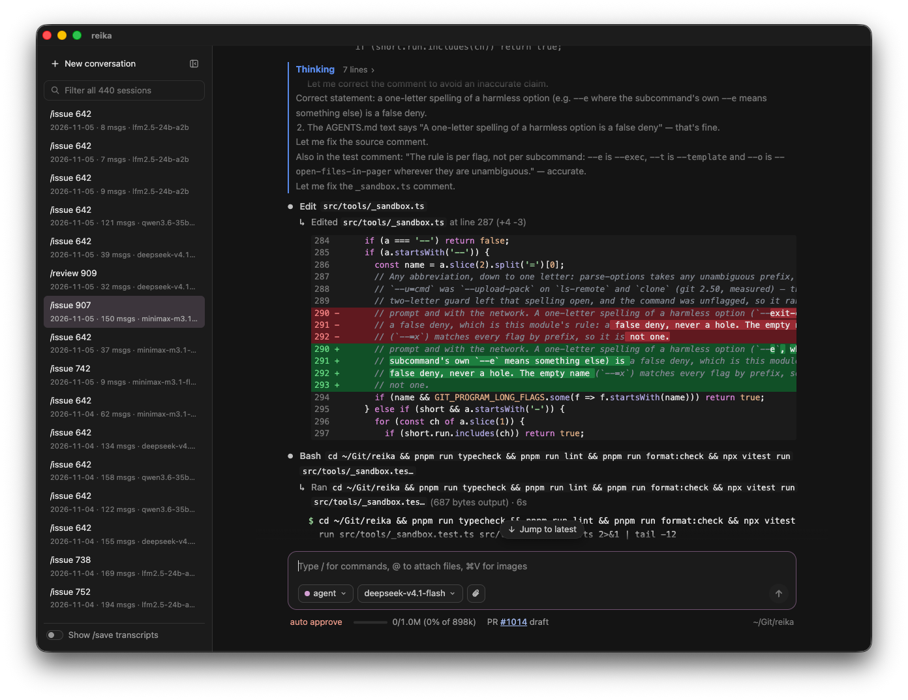

# Web front end

[← README](../README.md)

`reika web` serves the same agent to a browser tab on this machine. It runs the same session as the
terminal UI, with the same modes, tools, approvals, context handling and auto-save, just drawn in a
browser. It is **experimental**.



## Start it

```sh
cd your-project && reika web
```

Reika prints a link. Open it in a browser on the same machine. The link works once, within ten
minutes, and signs in that one tab. Press Enter in the terminal for a fresh link, for a second tab
or after the first one expires. ctrl-c stops the server, saving the conversation first.

```sh
reika web --window
```

This opens the page in an app window instead, with no tabs or address bar (and on macOS, its own Dock
icon). It uses whichever of Chrome, Edge, Brave or Chromium it finds first; `REIKA_CHROME_PATH`
points it at another. Without any of those it opens a tab in your default browser and says so.

- **Closing the window stops Reika**, the same way ctrl-c does. A reload does not, and if you also
  opened a tab from the terminal's Enter link, Reika keeps running until that tab closes too.
- **The window has its own browser profile**, under `~/.config/reika/window/`, so it never touches
  your everyday browser's tabs or sign-ins.
- **If the window shows an error** or never signs in, the terminal prints a fresh link after about
  20 seconds.

`--port <n>` picks the port. By default it takes a free one.

## The page

- **The transcript** draws the turn as the terminal does: tool calls and their results, diffs,
  command output, Thinking blocks (the end of the thought in view, the rest behind the `· N lines`
  toggle), the plan checklist, and the busy line with its spinner.
- **The input box** works like the terminal's: `/` for commands and `@` for files, both with
  completion, and ↑ and ↓ for the lines you sent. Shift+Enter, or a line ending in `\`, starts a new
  line instead of sending. A large paste is parked behind a marker, as in the terminal. While a turn
  runs, Enter queues the line, and Esc in an empty box stops the turn.
- **Images** go in by pasting (⌘V or Ctrl+V) or dropping a PNG, JPEG, WebP or GIF of up to 32 MB
  on the box, up to 8 per message. Each one lands as an `[Image N]` marker in the text with a chip
  under it, and is read straight away, the same way the terminal reads a pasted image: described by
  your vision model or system OCR, or sent as-is to a model that can see (see
  [Images](configuration.md#images)). The chip shows how many characters came out, or why the
  image could not be read. Click its thumbnail to see the image full size, or × to remove it.
  Enter waits until every image is read. Once sent, a line under your prompt says what was read
  from each image.
- **Two pills in the input box** switch the mode and the model. They are disabled while a prompt runs or
  waits, since switching then would change what the waiting line was typed for. The project
  folder's name sits beside Send, with its full path on hover; on a narrow screen it gives way to
  the pills.
- **The status line** shows the approval mode, how full the context is, the token counts, decode
  speed, cache hits and the branch's PR.
- **Approvals and questions** open as a card above the input. A number key moves to that option
  and Enter answers, so a stray key never answers for you. On an approval, `y` and `n` move to Yes
  and No. The arrow keys and the pointer also step through the options. An approval can take a
  reason to send with No. A question can take your own answer instead of an option, or a note to
  send with the option you pick. Esc cancels a model or session picker, or a question asked before
  sending. On an approval or a question from the model, Esc stops the turn and declines or drops it,
  as the stop button does.
- **History** lists this project's saved sessions, newest first, with a filter and a switch for
  your `/save` transcripts. Opening one replaces the conversation in place, as `/resume` does, and
  New conversation is `/new`. Both wait until no prompt is running. On a wide window, history is a
  collapsible pane beside the chat; on a narrow one it opens over the page.

## Not yet

- **More than one session per server.** The page drives one conversation, and opening a saved one
  replaces it rather than opening a second.
- **Joining a terminal session.** A browser tab cannot attach to a `reika` already running in a
  terminal. Each `reika web` is its own session.

## Security

The page can do whatever the agent can, so the server is locked down to this machine and this
link:

- It listens on `127.0.0.1` only, and refuses any request whose `Host` or `Origin` is not that
  address, which stops another site or a DNS-rebinding trick from reaching it.
- The link carries a one-time code in the part of the URL a browser never sends (after the `#`). A
  tab trades it for a token that only that tab keeps (in session storage), and every later request
  carries the token. There are no cookies.
- `--window` never puts the link on a command line, where other users on the machine could read it
  from the process list. The browser opens a private redirect file instead, deleted as soon as the
  code is used.
- An image is uploaded as its raw bytes with the same token, and the server checks that the bytes
  match the image type they claim to be. What was read from it stays on the server; the thumbnail is
  drawn from the browser's own copy of the file.
- Everything the page sends goes through the same approval gate and shell sandbox as the terminal.

## Configuration

| Key                   | Default | What                                                                               |
| --------------------- | ------- | ---------------------------------------------------------------------------------- |
| `REIKA_CHROME_PATH`   | _unset_ | The browser `--window` opens (and web search drives), instead of searching for one |
| `REIKA_WORKING_WORDS` | `1`     | `0` shows "Working" on the busy line instead of rotating verbs                     |

Everything else is shared with the terminal; see [Configuration](configuration.md).
